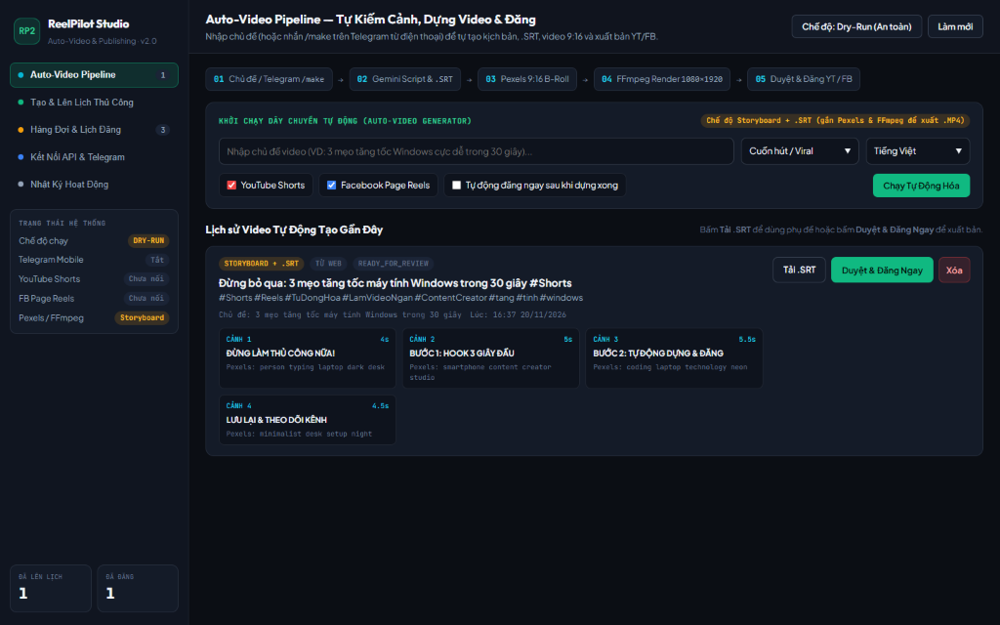

# ReelPilot Studio v2.0 — Auto-Video Pipeline, Telegram Mobile & Shorts/Reels Publisher

[](https://github.com/quoctuan364/reelpilot)
[](#)
[](#)
[](#)

**ReelPilot Studio v2.0** là hệ thống tự động hóa video ngắn `9:16` chạy cục bộ trên máy cá nhân (`Node.js >= 22.5 + node:sqlite WAL`, **0 thư viện ngoài**) — cho phép **ra lệnh từ điện thoại qua Telegram Bot → tự viết kịch bản & phụ đề `.SRT` bằng Gemini AI → tự tải cảnh nền 9:16 miễn phí từ Pexels → tự ghép giọng đọc & dựng `.MP4` bằng FFmpeg → duyệt 1 chạm và tự đăng lên YouTube Shorts & Facebook Page Reels**.



---

## Kiến trúc Dây Chuyền Tự Động (v2.0)

1. **Điều khiển từ điện thoại (`Telegram Bot`):** Nhắn `/make <chủ đề>` cho bot Telegram của riêng bạn → bot chạy toàn bộ quy trình rồi gửi video/kịch bản về điện thoại kèm nút **`✅ Duyệt & Đăng Ngay`**, **`⏰ Hẹn +1 Giờ`**, **`🗑 Xóa Nháp`**.
2. **Sinh kịch bản, cảnh quay & phụ đề `.SRT` (`Gemini 2.5 Flash`):** Tự động chia 4–6 cảnh kèm lời thoại, chữ phụ đề ngắn và từ khóa tiếng Anh tìm video nền (có sẵn **Offline Preview** khi chưa gắn key).
3. **Tự lấy video nền 9:16 sạch bản quyền (`Pexels Video API`):** Tự tìm và tải cảnh dọc HD không dính bản quyền theo từng cảnh kịch bản.
4. **Tự dựng `.MP4` 1080×1920 (`FFmpeg` + Windows Speech TTS):** Tự scale/crop 9:16, ghép các cảnh, trộn giọng đọc và đốt phụ đề chữ lớn trong vùng an toàn.
5. **Tự đăng đa nền tảng (`YouTube Data API v3` + `Meta Graph API v21.0`):** Hỗ trợ đầy đủ chế độ **Dry-Run (Chạy thử an toàn)** và **Live Publishing (Đăng thật)** kèm bộ lập lịch quét mỗi 15 giây.

---

## Khởi chạy nhanh (Windows 1-Click)

1. Nhấp đúp **`start-reelpilot.bat`** → mở trình duyệt tại `http://localhost:4330`.
2. *(Tùy chọn để bật render `.MP4` tự động)* Cài miễn phí FFmpeg bằng 1 lệnh PowerShell:
   ```powershell
   winget install Gyan.FFmpeg
   ```
   Sau đó mở lại `start-reelpilot.bat`.

---

## Hướng dẫn gắn tài khoản thật (tab *Kết Nối API & Telegram*)

1. **Telegram Bot (ra lệnh từ điện thoại):**
   - Mở Telegram tìm `@BotFather` → gõ `/newbot` → lấy **Bot Token** dán vào ReelPilot → bấm **Bật lắng nghe Telegram Bot**.
   - Nhắn `/start` cho bot trên điện thoại để bot trả về **Owner Chat ID**, dán mã này vào ReelPilot để khóa quyền chỉ riêng bạn sử dụng.
2. **Pexels API Key (miễn phí):** Đăng ký tại `https://www.pexels.com/api/` để tự tải video dọc `9:16` sạch bản quyền.
3. **Gemini API Key (miễn phí):** Lấy tại `https://aistudio.google.com/` để viết kịch bản & tiêu đề/hashtag bằng `gemini-2.5-flash`.
4. **YouTube Shorts (Google Cloud Console):** Bật **YouTube Data API v3**, tạo OAuth 2.0 Client ID với Redirect URI `http://localhost:4330/api/oauth/youtube/callback` → dán vào app → bấm **Kết nối Google / YouTube OAuth**.
5. **Facebook Page Reels (Meta for Developers):** Nhập **Facebook Page ID** (chỉ hỗ trợ Fanpage) và **Page Access Token** có quyền `pages_manage_posts`, `pages_read_engagement`.
6. Đổi chế độ từ **Dry-Run** sang **Live Publishing** khi sẵn sàng đăng thật.
